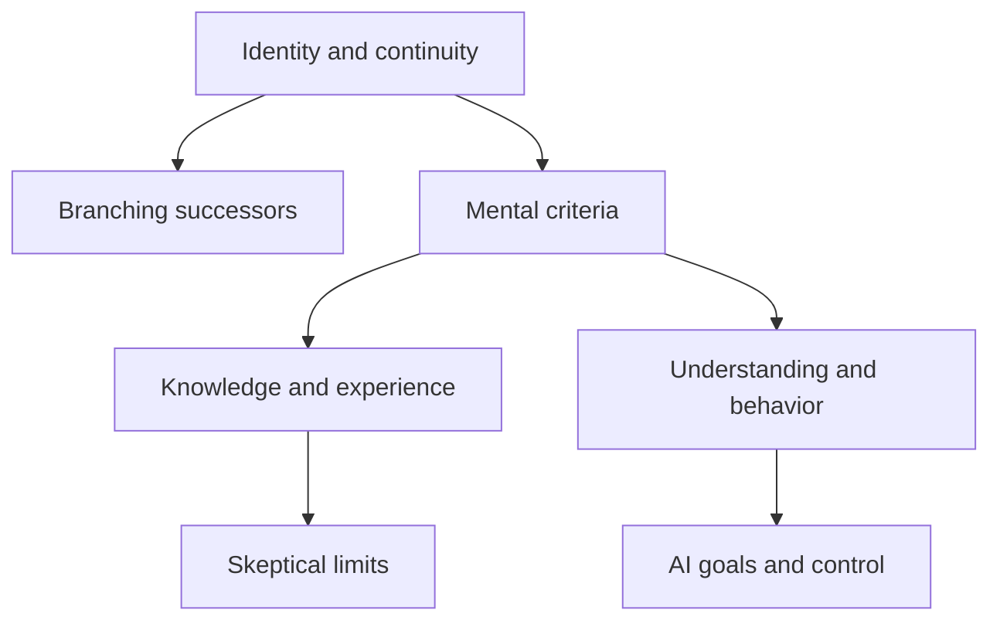

# Connections

Read related entries as tests of a shared assumption, not as interchangeable stories. The links below name what travels between cases and what does not.

## Persistence and replacement

[Ship of Theseus](experiments/identity/ship-of-theseus.md) ↔ [Teletransporter](experiments/identity/teletransporter.md)

The ship asks whether replacement preserves an object; the transporter adds psychological continuity and the possibility of a second claimant. A criterion that handles gradual replacement may fail when duplication is possible.

## Continuity without unique identity

[Teletransporter](experiments/identity/teletransporter.md) ↔ [Fission and Personal Identity](experiments/identity/fission.md)

Both distinguish survival-like continuity from numerical identity. Fission makes branching explicit: a relation can hold to two successors even though one person cannot be numerically identical to two distinct people.

## The limits of physical description

[Mary’s Room: The Knowledge Argument](experiments/consciousness/marys-room.md) ↔ [Philosophical Zombies](experiments/consciousness/zombies.md)

Mary asks whether physical knowledge captures phenomenal knowledge; zombies ask whether physical duplication entails experience. One is primarily epistemic, the other modal. Accepting an epistemic gap does not by itself establish a metaphysical gap.

## Behavior and understanding

[Chinese Room](experiments/consciousness/chinese-room.md) ↔ [The Turing Test](experiments/artificial-intelligence/turing-test.md)

Turing offers a behavioral comparison while Searle challenges an inference from formal symbol processing to understanding. They need not be contradictory if the test supplies evidence rather than a definition of mentality.

## Skeptical environments

[Brain in a Vat](experiments/epistemology/brain-in-a-vat.md) ↔ [Descartes’s Evil Demon](experiments/epistemology/evil-demon.md)

Both remove the usual connection between seeming and reality. A brain-in-a-vat argument may also raise semantic questions about what its words refer to; the demon scenario does not automatically settle those questions.

## Truth with epistemic luck

[Gettier Cases](experiments/epistemology/gettier-cases.md) ↔ [Fake-Barn Country](experiments/epistemology/fake-barn.md)

A Gettier case challenges justified true belief through luck in the route to truth. Fake barns place an accurate perception in an unreliable environment. Different anti-luck theories may treat these forms of luck differently.

## Numbers and constraints

[Trolley Problem](experiments/ethics/trolley.md) ↔ [Transplant Problem](experiments/ethics/transplant.md)

Both pit several lives against one, but redirecting an existing threat and using a person as a resource may differ morally. Footbridge variations, discussed with the trolley case, test which distinctions do the work.

## What gets maximized?

[Experience Machine](experiments/ethics/experience-machine.md) ↔ [Utility Monster](experiments/ethics/utility-monster.md)

The machine questions whether pleasure is all that matters; the monster tests what follows when benefits can be aggregated across unequal recipients. Rejecting hedonism does not automatically reject every form of consequentialism.

## Procedure and distribution

[The Veil of Ignorance and Original Position](experiments/society-and-justice/veil-of-ignorance.md) ↔ [Wilt Chamberlain’s Earnings](experiments/society-and-justice/wilt-chamberlain.md)

The original position asks what principles a fair choice procedure would support. The Chamberlain argument asks whether voluntary transfers upset patterned distributions. Their disagreement concerns institutions, entitlement, and what counts as a fair starting point.

## Prediction and agency

[Newcomb’s Problem](experiments/time-and-causality/newcomb.md) ↔ [Laplace’s Demon](experiments/time-and-causality/laplaces-demon.md)

A predictor makes the relationship between present action and an earlier prediction central. Deterministic predictability raises related questions about agency, but Newcomb’s recommendations cannot be read straight off a verdict about free will.

## Inconsistency and explanatory loops

[The Grandfather Paradox](experiments/time-and-causality/grandfather-paradox.md) ↔ [The Bootstrap / Causal-Loop Paradox](experiments/time-and-causality/bootstrap.md)

A grandfather case threatens a contradiction in a single history. A bootstrap loop can be self-consistent while lacking an ordinary external origin for information or an object. A causal loop is therefore not automatically a logical contradiction.

## Quantum descriptions and observers

[Schrödinger’s Cat](experiments/physics/schrodingers-cat.md) ↔ [Wigner’s Friend](experiments/physics/wigners-friend.md)

The cat magnifies the measurement problem; Wigner adds an observer who can be included in another observer’s quantum description. Neither establishes that human awareness causes collapse.

## Different questions about quantum reality

[The Einstein–Podolsky–Rosen Argument](experiments/physics/epr.md) ↔ [Wigner’s Friend](experiments/physics/wigners-friend.md)

EPR links completeness to locality and prediction. Wigner asks about descriptions of observers and measurements. Later experiments constrain particular assumptions; they do not make the two original arguments identical.

## Probability requires a procedure

[The Monty Hall Problem](experiments/mathematics/monty-hall.md) ↔ [Bertrand’s Random Chord Paradox](experiments/mathematics/bertrands-paradox.md)

Monty Hall depends on the host’s selection rule. Bertrand’s puzzle depends on how a random chord is generated. In both, a numerical answer without a sampling protocol conceals the issue.

## Individual incentives and collective loss

[The Prisoner’s Dilemma](experiments/economics/prisoners-dilemma.md) ↔ [The Tragedy of the Commons](experiments/economics/tragedy-of-the-commons.md)

The dilemma is a specified game; a commons is an institutional problem with many possible rules. Shared incentives do not prove that every common resource must fail or that one ownership arrangement is universally best.

## Goals and containment

[The Paperclip Maximizer](experiments/artificial-intelligence/paperclip-maximizer.md) ↔ [The AI Box Scenario](experiments/artificial-intelligence/ai-box.md)

A maximizer scenario explores consequences of an objective under strong capability assumptions. A box scenario explores limits on interaction and persuasion. Neither alone supplies a measured probability of future harm.

## How imagined cases discipline theory

[Galileo’s Tied Falling Bodies](experiments/physics/galileos-falling-bodies.md) ↔ [Darwin’s Imagined Gradations of the Eye](experiments/science-and-biology/darwins-eye.md)

Galileo’s argument pressures a claim about weight and falling speed; Darwin’s imagined examples test the intelligibility of gradual change. Physical contradiction, biological plausibility, and historical evidence are different forms of support.

## Sense, reference, and the environment

[Hesperus and Phosphorus](experiments/logic/hesperus-and-phosphorus.md) ↔ [Twin Earth](experiments/consciousness/twin-earth.md)

Frege’s puzzle shows that a name carries more than its referent; Twin Earth shows that the referent may depend on facts outside the speaker’s head. A theory of meaning has to respect both, and the two puzzles can pull in different directions.

## Meaning underdetermined by use

[Quine’s Gavagai](experiments/logic/gavagai.md) ↔ [Kripke’s Quus](experiments/logic/quus-rule-following.md) ↔ [Beetle in a Box](experiments/consciousness/beetle-in-box.md)

All three ask what fixes the meaning of a word when behaviour is finite. Quine concerns translation between speakers, Kripke the meaning that one speaker attaches to a rule, and Wittgenstein’s beetle a private object. Their conclusions differ, and treating them as one argument hides the differences.

## Projecting a pattern

[Goodman’s Grue](experiments/epistemology/grue.md) ↔ [Kripke’s Quus](experiments/logic/quus-rule-following.md)

Both use a gerrymandered predicate that fits all past data and diverges later. Goodman asks which generalizations evidence supports; Kripke asks which rule a speaker has been following. The structure is shared, but the targets are induction in one case and meaning in the other.

## What counts as evidence

[Hempel’s Ravens](experiments/epistemology/ravens-paradox.md) ↔ [Goodman’s Grue](experiments/epistemology/grue.md)

Hempel’s case challenges the idea that confirmation depends on logical form alone; Goodman’s shows that the choice of predicates matters. Together they suggest that evidence is always relative to background knowledge and a choice of vocabulary.

## Self-reference and unknowability

[The Grelling–Nelson Paradox](experiments/logic/grelling-nelson-paradox.md) ↔ [Russell’s Paradox](experiments/logic/russells-paradox.md) ↔ [Fitch’s Paradox of Knowability](experiments/logic/knowability-paradox.md)

Grelling–Nelson is a predicate version of Russell’s set paradox. Fitch’s argument uses a different kind of self-application: a truth that no one knows. The first two call for restricting definitions; the third calls for rethinking a thesis about truth and knowledge.

## Skeptical scenarios and the reply of common sense

[The Simulation Argument](experiments/epistemology/simulation-argument.md) ↔ [Brain in a Vat](experiments/epistemology/brain-in-a-vat.md) ↔ [Moore’s “Here Is One Hand”](experiments/epistemology/moores-proof-of-an-external-world.md)

The vat is a stipulated deception; the simulation argument adds probabilistic reasoning about the future. Moore replies to such scenarios by insisting that his everyday knowledge is more certain than the premises used against it. Whether that reply is satisfying is what separates the positions.

## Closure and skepticism

[The Cleverly Disguised Mule](experiments/epistemology/disguised-mule.md) ↔ [Fake-Barn Country](experiments/epistemology/fake-barn.md)

Both place a true perceptual belief in an environment where an alternative cannot be excluded. Dretske’s mule is about whether knowledge is closed under known entailment; the fake barn is about whether safety against nearby error is required. The cases test different principles.

## Infinity and completed tasks

[Zeno’s Dichotomy](experiments/logic/zenos-dichotomy.md) ↔ [Thomson’s Lamp](experiments/mathematics/thomsons-lamp.md) ↔ [Galileo’s Paradox of the Infinite](experiments/mathematics/galileos-paradox.md)

Zeno asks whether an infinite series of steps can be completed; Thomson asks what state results; Galileo asks whether an infinite collection can match a part of itself. The mathematics of limits and cardinality answers some versions and leaves the physical and philosophical questions open.

## Motion and the frame of reference

[Galileo’s Ship](experiments/physics/galileos-ship.md) ↔ [Newton’s Bucket](experiments/physics/newtons-bucket.md) ↔ [Einstein’s Train](experiments/physics/einsteins-train.md)

Galileo shows that uniform motion is undetectable by local experiments. Newton argues that rotation, by contrast, is detectable and so requires something more than relative motion. Einstein shows that even simultaneity depends on the observer’s motion. Each rejects a different assumption about what is absolute.

## Symmetry and determinism in physics

[The Hole Argument](experiments/physics/hole-argument.md) ↔ [Loschmidt’s Reversibility Objection](experiments/physics/loschmidt-reversibility.md)

The hole argument asks whether the symmetries of a theory leave the future undetermined. Loschmidt asks how time-symmetric laws can yield an arrow of time. In both, a formal property of the laws has consequences that are not obvious at first sight.

## Fate and the open future

[The Idle Argument](experiments/time-and-causality/idle-argument.md) ↔ [Aristotle’s Sea Battle](experiments/time-and-causality/sea-battle.md)

The idle argument reasons from what will happen to what we should do; the sea battle reasons from what is true now to what must happen. Both resist fatalism by identifying a step that confuses truth with necessity or fate with independence from our actions.

## Manipulation and responsibility

[Pereboom’s Four-Case Argument](experiments/time-and-causality/four-case-argument.md) ↔ [Frankfurt Cases](experiments/time-and-causality/frankfurt-cases.md)

Frankfurt’s cases test whether alternatives are needed for responsibility; Pereboom’s ask whether the history of an agent’s motives matters. A view can accept the first without accepting the conclusion of the second, so the two should be considered separately.

## Luck, outcomes, and responsibility

[Williams’s Lorry Driver](experiments/ethics/lorry-driver.md) ↔ [Frankfurt Cases](experiments/time-and-causality/frankfurt-cases.md)

The driver’s case shows outcomes affecting how we assess a person; Frankfurt’s cases show the possibility of responsibility without alternatives. Both put pressure on the idea that responsibility tracks only what is in the agent’s control.

## Integrity, doing, and allowing

[Jim and the Captain](experiments/ethics/jim-and-the-captain.md) ↔ [Smith and Jones](experiments/ethics/smith-and-jones-bathtub.md) ↔ [The Terror Bomber and the Tactical Bomber](experiments/ethics/terror-and-tactical-bomber.md)

Jim asks whether an agent’s own agency matters; Smith and Jones whether acting differs from allowing; the bombers whether intending differs from foreseeing. Each isolates a distinction that deontological views use and consequentialists question.

## Coincidence and counting

[Lumpl and Goliath](experiments/identity/statue-and-clay.md) ↔ [Dion and Theon](experiments/identity/dion-and-theon.md) ↔ [The Problem of the Many](experiments/identity/problem-of-the-many.md)

These puzzles all concern when we have one object and when more. Lumpl and Goliath concern matter shared by two apparent things, Dion and Theon the removal of a part, and the problem of the many the fuzzy edge of a single thing. Solutions that work for one can fail for another.

## Trust versus temptation

[The Stag Hunt](experiments/economics/stag-hunt.md) ↔ [The Prisoner’s Dilemma](experiments/economics/prisoners-dilemma.md)

In the dilemma, defection is tempting whatever the other does; in the stag hunt, cooperation is best if the other cooperates. The first calls for changing incentives, the second for building assurance, so the same word “cooperation” hides different problems.

## Combining preferences

[The Condorcet Paradox](experiments/society-and-justice/condorcet-paradox.md) ↔ [Arrow’s Impossibility Theorem](experiments/society-and-justice/arrows-impossibility-theorem.md) ↔ [Sen’s Paradox of the Paretian Liberal](experiments/society-and-justice/sens-liberal-paradox.md)

Condorcet gives an example of a cycle, Arrow generalizes it to a theorem, and Sen shows a conflict between liberty and efficiency. They are three stages of the same theme: no procedure for aggregating preferences is free of cost.

## Tiny probabilities and large stakes

[Pascal’s Wager](experiments/economics/pascals-wager.md) ↔ [Pascal’s Mugging](experiments/economics/pascals-mugging.md) ↔ [The St. Petersburg Paradox](experiments/mathematics/st-petersburg-paradox.md)

Each uses an unbounded or very large payoff to strain expected-value maximization. The wager invokes an infinite reward, the mugging an exploitable promise, and the St. Petersburg game an infinite expected value from a finite game. Responses such as bounded utility apply differently to each.

## Behaviour, structure, and meaning in machines

[Blockhead](experiments/artificial-intelligence/blockhead.md) ↔ [The Chinese Room](experiments/consciousness/chinese-room.md) ↔ [The Symbol Grounding Problem](experiments/artificial-intelligence/symbol-grounding.md)

Blockhead says that behaviour alone does not show intelligence; Searle says that symbol manipulation alone does not show understanding; Harnad asks what could connect symbols to the world. Each identifies a different missing ingredient.

## Design and explanation

[Paley’s Watch](experiments/science-and-biology/paleys-watch.md) ↔ [Darwin’s Imagined Gradations of the Eye](experiments/science-and-biology/darwins-eye.md) ↔ [Leslie’s Firing Squad](experiments/science-and-biology/leslies-firing-squad.md)

Paley infers design from adaptation, Darwin proposes a natural route to adaptation, and Leslie asks whether our existence removes the need to explain a rare cosmic condition. The second answers the first for biology and does not automatically answer the third.

## A compact conceptual map

The diagram maps questions, not conclusions or historical influence. Follow the article links above for concrete cases.

[Return to the collection](README.md)
