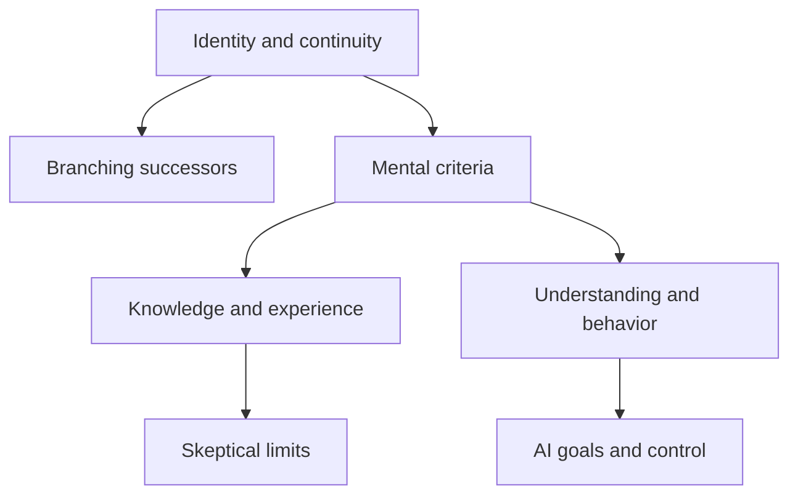

# Connections

Read related entries as tests of a shared assumption, not as interchangeable stories. The links below name what travels between cases and what does not.

## Persistence and replacement

[Ship of Theseus](experiments/identity/ship-of-theseus.md) ↔ [Teletransporter](experiments/identity/teletransporter.md)

The ship asks whether replacement preserves an object; the transporter adds psychological continuity and the possibility of a second claimant. A criterion that handles gradual replacement may fail when duplication is possible.

## Continuity without unique identity

[Teletransporter](experiments/identity/teletransporter.md) ↔ [Fission and Personal Identity](experiments/identity/fission.md)

Both distinguish survival-like continuity from numerical identity. Fission makes branching explicit: a relation can hold to two successors even though one person cannot be numerically identical to two distinct people.

## The limits of physical description

[Mary’s Room: The Knowledge Argument](experiments/consciousness/marys-room.md) ↔ [Philosophical Zombies](experiments/consciousness/zombies.md)

Mary asks whether physical knowledge captures phenomenal knowledge; zombies ask whether physical duplication entails experience. One is primarily epistemic, the other modal. Accepting an epistemic gap does not by itself establish a metaphysical gap.

## Behavior and understanding

[Chinese Room](experiments/consciousness/chinese-room.md) ↔ [The Turing Test](experiments/artificial-intelligence/turing-test.md)

Turing offers a behavioral comparison while Searle challenges an inference from formal symbol processing to understanding. They need not be contradictory if the test supplies evidence rather than a definition of mentality.

## Skeptical environments

[Brain in a Vat](experiments/epistemology/brain-in-a-vat.md) ↔ [Descartes’s Evil Demon](experiments/epistemology/evil-demon.md)

Both remove the usual connection between seeming and reality. A brain-in-a-vat argument may also raise semantic questions about what its words refer to; the demon scenario does not automatically settle those questions.

## Truth with epistemic luck

[Gettier Cases](experiments/epistemology/gettier-cases.md) ↔ [Fake-Barn Country](experiments/epistemology/fake-barn.md)

A Gettier case challenges justified true belief through luck in the route to truth. Fake barns place an accurate perception in an unreliable environment. Different anti-luck theories may treat these forms of luck differently.

## Numbers and constraints

[Trolley Problem](experiments/ethics/trolley.md) ↔ [Transplant Problem](experiments/ethics/transplant.md)

Both pit several lives against one, but redirecting an existing threat and using a person as a resource may differ morally. Footbridge variations, discussed with the trolley case, test which distinctions do the work.

## What gets maximized?

[Experience Machine](experiments/ethics/experience-machine.md) ↔ [Utility Monster](experiments/ethics/utility-monster.md)

The machine questions whether pleasure is all that matters; the monster tests what follows when benefits can be aggregated across unequal recipients. Rejecting hedonism does not automatically reject every form of consequentialism.

## Procedure and distribution

[The Veil of Ignorance and Original Position](experiments/society-and-justice/veil-of-ignorance.md) ↔ [Wilt Chamberlain’s Earnings](experiments/society-and-justice/wilt-chamberlain.md)

The original position asks what principles a fair choice procedure would support. The Chamberlain argument asks whether voluntary transfers upset patterned distributions. Their disagreement concerns institutions, entitlement, and what counts as a fair starting point.

## Prediction and agency

[Newcomb’s Problem](experiments/time-and-causality/newcomb.md) ↔ [Laplace’s Demon](experiments/time-and-causality/laplaces-demon.md)

A predictor makes the relationship between present action and an earlier prediction central. Deterministic predictability raises related questions about agency, but Newcomb’s recommendations cannot be read straight off a verdict about free will.

## Inconsistency and explanatory loops

[The Grandfather Paradox](experiments/time-and-causality/grandfather-paradox.md) ↔ [The Bootstrap / Causal-Loop Paradox](experiments/time-and-causality/bootstrap.md)

A grandfather case threatens a contradiction in a single history. A bootstrap loop can be self-consistent while lacking an ordinary external origin for information or an object. A causal loop is therefore not automatically a logical contradiction.

## Quantum descriptions and observers

[Schrödinger’s Cat](experiments/physics/schrodingers-cat.md) ↔ [Wigner’s Friend](experiments/physics/wigners-friend.md)

The cat magnifies the measurement problem; Wigner adds an observer who can be included in another observer’s quantum description. Neither establishes that human awareness causes collapse.

## Different questions about quantum reality

[The Einstein–Podolsky–Rosen Argument](experiments/physics/epr.md) ↔ [Wigner’s Friend](experiments/physics/wigners-friend.md)

EPR links completeness to locality and prediction. Wigner asks about descriptions of observers and measurements. Later experiments constrain particular assumptions; they do not make the two original arguments identical.

## Probability requires a procedure

[The Monty Hall Problem](experiments/mathematics/monty-hall.md) ↔ [Bertrand’s Random Chord Paradox](experiments/mathematics/bertrands-paradox.md)

Monty Hall depends on the host’s selection rule. Bertrand’s puzzle depends on how a random chord is generated. In both, a numerical answer without a sampling protocol conceals the issue.

## Individual incentives and collective loss

[The Prisoner’s Dilemma](experiments/economics/prisoners-dilemma.md) ↔ [The Tragedy of the Commons](experiments/economics/tragedy-of-the-commons.md)

The dilemma is a specified game; a commons is an institutional problem with many possible rules. Shared incentives do not prove that every common resource must fail or that one ownership arrangement is universally best.

## Goals and containment

[The Paperclip Maximizer](experiments/artificial-intelligence/paperclip-maximizer.md) ↔ [The AI Box Scenario](experiments/artificial-intelligence/ai-box.md)

A maximizer scenario explores consequences of an objective under strong capability assumptions. A box scenario explores limits on interaction and persuasion. Neither alone supplies a measured probability of future harm.

## How imagined cases discipline theory

[Galileo’s Tied Falling Bodies](experiments/physics/galileos-falling-bodies.md) ↔ [Darwin’s Imagined Gradations of the Eye](experiments/science-and-biology/darwins-eye.md)

Galileo’s argument pressures a claim about weight and falling speed; Darwin’s imagined examples test the intelligibility of gradual change. Physical contradiction, biological plausibility, and historical evidence are different forms of support.

## A compact conceptual map

The diagram maps questions, not conclusions or historical influence. Follow the article links above for concrete cases.

[Return to the collection](README.md)
