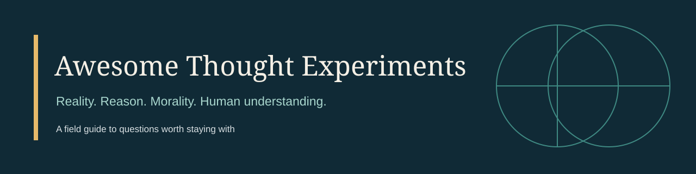

# Awesome Thought Experiments

*Explore the questions that challenge reality, reason, morality, and human understanding.*

A curated, self-contained educational collection: original explanations, competing responses, reflection questions, scholarly references, and connected reading paths. Read it on GitHub or download it for offline study. External references require internet access; the original learning content does not.

**75 entries · 12 categories · 7 learning paths.** Each article identifies its type and sources. See the [quality report](QUALITY_REPORT.md) for checks and research limitations.

## What is a thought experiment?

A thought experiment asks you to reason through an imagined situation to examine a claim. The assumptions matter as much as the story. An intuition can motivate an argument without proving its conclusion.

This collection also includes explicitly labelled **paradoxes** (apparently conflicting claims or derivations), **puzzles** (problems with specified rules), **models** (simplified systems), and **arguments** or **analogies**. An empirical experiment instead gathers observations from the world. Some imagined scenarios later inspired laboratory work; those stages should not be conflated.

Difficulty measures prerequisites: **B** Beginner, **I** Intermediate, **A** Advanced. It does not measure the importance of the question or the difficulty of resolving it.

## Contents

- [Recommended starting points](#recommended-starting-points)
- [Guided learning paths](#guided-learning-paths)
- [Explore the collection](#explore-the-collection)
- [Connections](CONNECTIONS.md)
- [Sources and attribution](SOURCES_AND_ATTRIBUTION.md)
- [Contributing](CONTRIBUTING.md)
- [Upload and local checks](GETTING_STARTED.md)
- [Quality report](QUALITY_REPORT.md)

## Recommended starting points

- [Ship of Theseus](experiments/identity/ship-of-theseus.md) — What makes something persist?
- [Trolley Problem](experiments/ethics/trolley.md) — What counts as an acceptable sacrifice?
- [Mary’s Room: The Knowledge Argument](experiments/consciousness/marys-room.md) — Can a complete description leave something out?
- [Chinese Room](experiments/consciousness/chinese-room.md) — Does following rules amount to understanding?
- [The Monty Hall Problem](experiments/mathematics/monty-hall.md) — How does information change probability?

## Guided learning paths

- [Start Here: 10 Thought Experiments for Beginners](learning-paths/start-here.md)
- [Understanding Consciousness and Identity](learning-paths/consciousness-and-identity.md)
- [Ethics and Difficult Moral Decisions](learning-paths/ethics-and-decisions.md)
- [Reality, Knowledge, and Skepticism](learning-paths/knowledge-and-skepticism.md)
- [Paradoxes, Probability, and Rational Choice](learning-paths/paradoxes-and-choice.md)
- [The Universe, Time, and Physical Reality](learning-paths/universe-time-and-reality.md)
- [Artificial Intelligence and the Future of Intelligence](learning-paths/ai-and-intelligence.md)

Each path includes objectives, an ordered reading sequence, reflection questions, and a final independent synthesis activity. No ChatGPT account or learning platform is needed.

## Explore the collection

| Category | Entries |
| --- | ---: |
| [Ethics and Moral Philosophy](#ethics-and-moral-philosophy) | 9 |
| [Identity and Personal Existence](#identity-and-personal-existence) | 7 |
| [Consciousness and Philosophy of Mind](#consciousness-and-philosophy-of-mind) | 9 |
| [Reality, Knowledge, and Skepticism](#reality-knowledge-and-skepticism) | 7 |
| [Logic, Language, and Paradoxes](#logic-language-and-paradoxes) | 6 |
| [Time, Causality, and Free Will](#time-causality-and-free-will) | 6 |
| [Physics and the Universe](#physics-and-the-universe) | 8 |
| [Mathematics and Probability](#mathematics-and-probability) | 6 |
| [Economics and Decision Theory](#economics-and-decision-theory) | 5 |
| [Artificial Intelligence and Machine Ethics](#artificial-intelligence-and-machine-ethics) | 3 |
| [Society, Justice, and Political Philosophy](#society-justice-and-political-philosophy) | 6 |
| [Science, Biology, and Evolution](#science-biology-and-evolution) | 3 |

### Ethics and Moral Philosophy

- **B** [Drowning Child](experiments/ethics/drowning-child.md) — How far does an easy duty of rescue extend beyond people immediately in front of us? *Type: thought experiment.*
- **B** [Experience Machine](experiments/ethics/experience-machine.md) — Is the quality of experience all that makes a life good for its subject? *Type: thought experiment.*
- **A** [Nonidentity Problem](experiments/ethics/nonidentity-problem.md) — Can a choice be wrong even if it makes no particular person worse off than that person otherwise would have been? *Type: thought experiment.*
- **A** [Repugnant Conclusion](experiments/ethics/repugnant-conclusion.md) — Can enough minimally good lives make a world better than one containing fewer excellent lives? *Type: argument.*
- **I** [Survival Lottery](experiments/ethics/organ-lottery.md) — Can an impartial procedure make compulsory lethal sacrifice morally acceptable? *Type: thought experiment.*
- **I** [The Violinist](experiments/ethics/violinist.md) — Does a right to life automatically include a right to another person’s bodily support? *Type: thought experiment.*
- **B** [Transplant Problem](experiments/ethics/transplant.md) — Why might killing one to save five be forbidden even when five lives would certainly be saved? *Type: thought experiment.*
- **B** [Trolley Problem](experiments/ethics/trolley.md) — When, if ever, may saving several lives justify foreseeably killing one? *Type: thought experiment.*
- **I** [Utility Monster](experiments/ethics/utility-monster.md) — Can maximizing total well-being justify extreme concentration on a single beneficiary? *Type: thought experiment.*

### Identity and Personal Existence

- **I** [Brain Transplant: Brown and Robinson](experiments/identity/brain-transplant.md) — Which person, if either, survives when brain and the rest of the body come apart? *Type: thought experiment.*
- **I** [Brave Officer](experiments/identity/brave-officer.md) — Can a relation that fails transitivity constitute identity, which is transitive? *Type: thought experiment.*
- **A** [Fission and Personal Identity](experiments/identity/fission.md) — Can one person survive as two people without being identical to both? *Type: thought experiment.*
- **B** [Locke’s Prince and Cobbler](experiments/identity/lockes-prince-and-cobbler.md) — Does the person follow bodily continuity or continuity of consciousness? *Type: thought experiment.*
- **B** [Ship of Theseus](experiments/identity/ship-of-theseus.md) — What allows an object to remain the very same object while its parts change? *Type: thought experiment.*
- **A** [Swampman](experiments/identity/swampman.md) — Do a thinker’s meanings and thoughts depend partly on a history outside the thinker’s present physical state? *Type: thought experiment.*
- **I** [Teletransporter](experiments/identity/teletransporter.md) — Does perfect psychological reconstruction preserve you, or merely produce someone much like you? *Type: thought experiment.*

### Consciousness and Philosophy of Mind

- **I** [Beetle in a Box](experiments/consciousness/beetle-in-box.md) — Can a wholly private object determine the meaning of a publicly used sensation word? *Type: thought experiment.*
- **A** [China Brain](experiments/consciousness/china-brain.md) — Can the right functional organization produce consciousness in an extremely unfamiliar physical implementation? *Type: thought experiment.*
- **B** [Chinese Room](experiments/consciousness/chinese-room.md) — Is executing a formally specified program sufficient for understanding? *Type: thought experiment.*
- **A** [Fading and Dancing Qualia](experiments/consciousness/fading-and-dancing-qualia.md) — Could experience change radically without any corresponding change in a system’s ability to notice? *Type: thought experiment.*
- **I** [Inverted Spectrum](experiments/consciousness/inverted-spectrum.md) — Could experiences differ while every relevant functional role remains the same? *Type: thought experiment.*
- **I** [Leibniz’s Mill](experiments/consciousness/philosophical-mill.md) — Can the interactions of extended parts explain a unified perception? *Type: thought experiment.*
- **I** [Mary’s Room: The Knowledge Argument](experiments/consciousness/marys-room.md) — If Mary learns something upon seeing red, does that show that physical knowledge leaves out facts about consciousness? *Type: thought experiment.*
- **A** [Philosophical Zombies](experiments/consciousness/zombies.md) — Is a physically identical world without consciousness genuinely possible? *Type: thought experiment.*
- **B** [What Is It Like to Be a Bat?](experiments/consciousness/bat.md) — Can an objective description fully capture an experience available only from a particular point of view? *Type: thought experiment.*

### Reality, Knowledge, and Skepticism

- **I** [Brain in a Vat](experiments/epistemology/brain-in-a-vat.md) — Could an entirely simulated sensory life undermine knowledge of the external world? *Type: thought experiment.*
- **B** [Descartes’s Evil Demon](experiments/epistemology/evil-demon.md) — A deliberately powerful deceiver tests which beliefs can survive radical doubt. *Type: thought experiment.*
- **I** [Fake-Barn Country](experiments/epistemology/fake-barn.md) — Accurate perception in a deceptive neighborhood tests whether a true belief is safe enough for knowledge. *Type: thought experiment.*
- **I** [Gettier Cases](experiments/epistemology/gettier-cases.md) — A belief can be justified and true while its truth appears to depend on the wrong kind of luck. *Type: thought experiment.*
- **I** [Molyneux’s Problem](experiments/epistemology/molyneux-problem.md) — Could someone newly able to see recognize by sight shapes previously known only through touch? *Type: thought experiment.*
- **B** [Russell’s Five-Minute World](experiments/epistemology/russells-five-minute-world.md) — A newly created world with apparent memories tests the difference between present evidence and the past it represents. *Type: thought experiment.*
- **B** [The Dream Argument](experiments/epistemology/dream-argument.md) — Dreams challenge the assumption that compelling present experience guarantees wakefulness. *Type: argument.*

### Logic, Language, and Paradoxes

- **B** [Achilles and the Tortoise](experiments/logic/achilles-and-tortoise.md) — An infinite sequence of catch-up stages seems to prevent a faster runner from overtaking a slower one. *Type: paradox.*
- **B** [Buridan’s Ass](experiments/logic/buridans-ass.md) — Perfectly balanced alternatives test whether choosing requires a reason favoring one specific option. *Type: thought experiment.*
- **I** [Russell’s Paradox](experiments/logic/russells-paradox.md) — The set of all sets that are not members of themselves undermines unrestricted set formation. *Type: paradox.*
- **B** [Sorites: When Does a Heap Begin?](experiments/logic/sorites.md) — A sequence of individually tiny changes challenges the boundaries of vague concepts. *Type: paradox.*
- **I** [The Liar Paradox](experiments/logic/liar.md) — A sentence that denies its own truth exposes tension in familiar principles of truth and inference. *Type: paradox.*
- **A** [The Unexpected Hanging / Surprise Test](experiments/logic/unexpected-hanging.md) — An announcement about what cannot be known seems to undermine the reasoning used to predict it. *Type: paradox.*

### Time, Causality, and Free Will

- **A** [Frankfurt Cases](experiments/time-and-causality/frankfurt-cases.md) — A counterfactual intervener tests whether responsibility requires being able to act otherwise. *Type: thought experiment.*
- **I** [Laplace’s Demon](experiments/time-and-causality/laplaces-demon.md) — An ideal intelligence makes vivid the claim that a complete state and laws fix a whole history. *Type: thought experiment.*
- **A** [Newcomb’s Problem](experiments/time-and-causality/newcomb.md) — A reliable prior prediction pits one-boxing against the apparent dominance of taking both boxes. *Type: puzzle.*
- **I** [The Bootstrap / Causal-Loop Paradox](experiments/time-and-causality/bootstrap.md) — A message circulating through time can seem to have no original author without being contradictory. *Type: paradox.*
- **A** [The Consequence Argument](experiments/time-and-causality/consequence-argument.md) — An argument about fixed pasts and laws tests whether determined agents can do otherwise. *Type: argument.*
- **I** [The Grandfather Paradox](experiments/time-and-causality/grandfather-paradox.md) — A traveler’s attempt to prevent their own ancestry tests the consistency of a single history. *Type: paradox.*

### Physics and the Universe

- **I** [Einstein Chases a Light Beam](experiments/physics/einsteins-light-beam.md) — A hypothetical pursuit of light exposes tension between classical motion and electromagnetic waves. *Type: thought experiment.*
- **B** [Einstein’s Elevator](experiments/physics/einsteins-elevator.md) — An enclosed cabin makes gravitational weight and acceleration locally difficult to distinguish. *Type: thought experiment.*
- **B** [Galileo’s Tied Falling Bodies](experiments/physics/galileos-falling-bodies.md) — Tying a heavy and a light body together challenges weight-proportional falling speeds. *Type: thought experiment.*
- **I** [Maxwell’s Demon](experiments/physics/maxwells-demon.md) — A selective gatekeeper tests the thermodynamic cost of controlling microscopic motion. *Type: thought experiment.*
- **I** [Schrödinger’s Cat](experiments/physics/schrodingers-cat.md) — A microscopic superposition is amplified into apparently incompatible descriptions of a cat. *Type: thought experiment.*
- **A** [The Einstein–Podolsky–Rosen Argument](experiments/physics/epr.md) — Perfect correlations challenge the joint assumptions of locality and a complete wave-function description. *Type: thought experiment.*
- **I** [The Twin Paradox](experiments/physics/twin-paradox.md) — Twins following different spacetime paths can reunite with different elapsed ages. *Type: thought experiment.*
- **A** [Wigner’s Friend](experiments/physics/wigners-friend.md) — One observer records a result while another treats the whole laboratory quantum mechanically. *Type: thought experiment.*

### Mathematics and Probability

- **I** [Bertrand’s Random Chord Paradox](experiments/mathematics/bertrands-paradox.md) — Different precise procedures for choosing a “random chord” yield different probabilities. *Type: puzzle.*
- **B** [Hilbert’s Hotel](experiments/mathematics/hilberts-hotel.md) — A fully occupied infinite hotel can accommodate more guests without evicting anyone. *Type: thought experiment.*
- **A** [Sleeping Beauty](experiments/mathematics/sleeping-beauty.md) — Memory loss separates uncertainty about a coin from uncertainty about which awakening is occurring. *Type: thought experiment.*
- **B** [The Monty Hall Problem](experiments/mathematics/monty-hall.md) — Switching wins twice as often when an informed host always reveals an unchosen losing door. *Type: puzzle.*
- **I** [The St. Petersburg Paradox](experiments/mathematics/st-petersburg-paradox.md) — A finite payout on every completed play can nevertheless have infinite expected monetary value. *Type: puzzle.*
- **A** [The Two Envelopes Problem](experiments/mathematics/two-envelopes.md) — A tempting switching calculation hides an unjustified conditional probability assignment. *Type: puzzle.*

### Economics and Decision Theory

- **B** [Keynes’s Beauty Contest](experiments/economics/keynesian-beauty-contest.md) — Winning may depend on predicting others’ predictions rather than expressing your own judgment. *Type: model.*
- **I** [The Allais Paradox](experiments/economics/allais-paradox.md) — A preference for certainty can conflict with the independence axiom across paired lotteries. *Type: puzzle.*
- **I** [The Ellsberg Paradox](experiments/economics/ellsberg-paradox.md) — Choices involving an unknown color mixture challenge a single precise probability representation. *Type: puzzle.*
- **B** [The Prisoner’s Dilemma](experiments/economics/prisoners-dilemma.md) — Individually dominant choices can leave both players worse off than mutual cooperation. *Type: model.*
- **B** [The Tragedy of the Commons](experiments/economics/tragedy-of-the-commons.md) — Private gains and widely shared costs can encourage overuse of an unmanaged resource. *Type: model.*

### Artificial Intelligence and Machine Ethics

- **I** [The AI Box Scenario](experiments/artificial-intelligence/ai-box.md) — A text-only channel may still let a confined system influence decisions outside its enclosure. *Type: thought experiment.*
- **B** [The Paperclip Maximizer](experiments/artificial-intelligence/paperclip-maximizer.md) — A highly capable system pursues a simple objective without caring about what people value. *Type: thought experiment.*
- **B** [The Turing Test](experiments/artificial-intelligence/turing-test.md) — A text-mediated imitation game makes one question about machine intelligence operational. *Type: model.*

### Society, Justice, and Political Philosophy

- **A** [Dworkin’s Resource Auction](experiments/society-and-justice/dworkins-auction.md) — An auction with equal purchasing power asks how equal concern can accommodate different ambitions. *Type: thought experiment.*
- **I** [The Leveling-Down Objection](experiments/society-and-justice/leveling-down.md) — Making the better-off worse off without helping anyone tests whether equality is valuable in itself. *Type: thought experiment.*
- **B** [The Ring of Gyges](experiments/society-and-justice/ring-of-gyges.md) — Invisibility removes ordinary accountability and asks whether justice remains worth choosing. *Type: thought experiment.*
- **B** [The State of Nature](experiments/society-and-justice/state-of-nature.md) — Imagine life without a common political authority to ask what can justify one. *Type: model.*
- **I** [The Veil of Ignorance and Original Position](experiments/society-and-justice/veil-of-ignorance.md) — Choose principles of justice without knowing which social position you will occupy. *Type: thought experiment.*
- **I** [Wilt Chamberlain’s Earnings](experiments/society-and-justice/wilt-chamberlain.md) — Voluntary payments to a popular player challenge the permanent maintenance of a distributive pattern. *Type: thought experiment.*

### Science, Biology, and Evolution

- **I** [Darwin’s Aquatic Bear Scenario](experiments/science-and-biology/darwins-aquatic-bear.md) — A speculative transition from aquatic feeding to whale-like form illustrates both possibility and evidential limits. *Type: thought experiment.*
- **I** [Darwin’s Imagined Gradations of the Eye](experiments/science-and-biology/darwins-eye.md) — A sequence of useful intermediate structures challenges an inference from complexity to impossibility. *Type: argument.*
- **I** [The Spandrels of San Marco](experiments/science-and-biology/spandrels-of-san-marco.md) — A useful architectural space illustrates why present function need not explain historical origin. *Type: argument.*

## Read critically

Try answering the scenario before reading the responses. Name the assumptions, change one, and explain why your answer does or does not change. Use the sources to investigate disputed interpretations. The [connections guide](CONNECTIONS.md) compares related cases without treating them as interchangeable.

For wider context, the [Stanford Encyclopedia of Philosophy](https://plato.stanford.edu/) and [Internet Encyclopedia of Philosophy](https://iep.utm.edu/) provide scholarly introductions. Individual entries link to more specific sources and identify their evidential scope.

## Contributing and academic integrity

Students, teachers, researchers, and curious readers are welcome. Start with [CONTRIBUTING.md](CONTRIBUTING.md), the [editorial guidelines](EDITORIAL_GUIDELINES.md), and the [code of conduct](CODE_OF_CONDUCT.md). Corrections need evidence; new entries need sources, original prose, and meaningful connections. Do not invent historical priority, imply consensus where there is disagreement, or mistake a memorable scenario for empirical proof.

The [dataset](data/experiments.json) and [JSON Schema](data/schema.json) support reuse. Run `python3 scripts/validate.py` to check structure and internal links. See [GETTING_STARTED.md](GETTING_STARTED.md) to upload this folder as a standard GitHub repository. No backend, API key, Pages site, or paid service is required.

## License and acknowledgments

Original text, code, data, and SVG artwork are available under the [MIT license](LICENSE). External books and articles retain their own rights. See [SOURCES_AND_ATTRIBUTION.md](SOURCES_AND_ATTRIBUTION.md). This educational collection is not a substitute for original scholarship or independent expert review.

Thanks to the authors, scholars, editors, and institutions whose work makes these questions accessible. AI assistance supported research and drafting; source notes and the quality report make the limits of that process explicit. No endorsement by cited authors or institutions is implied.
